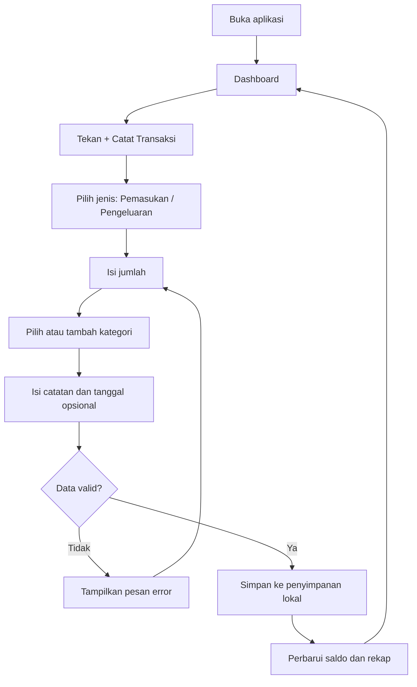
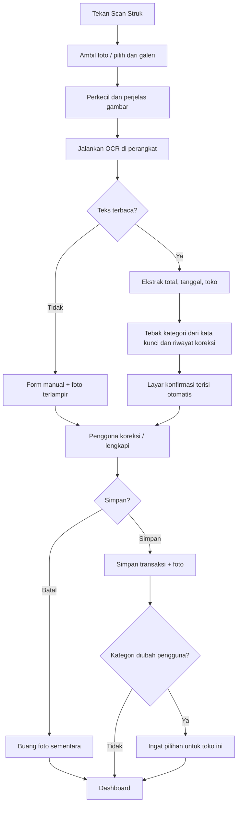
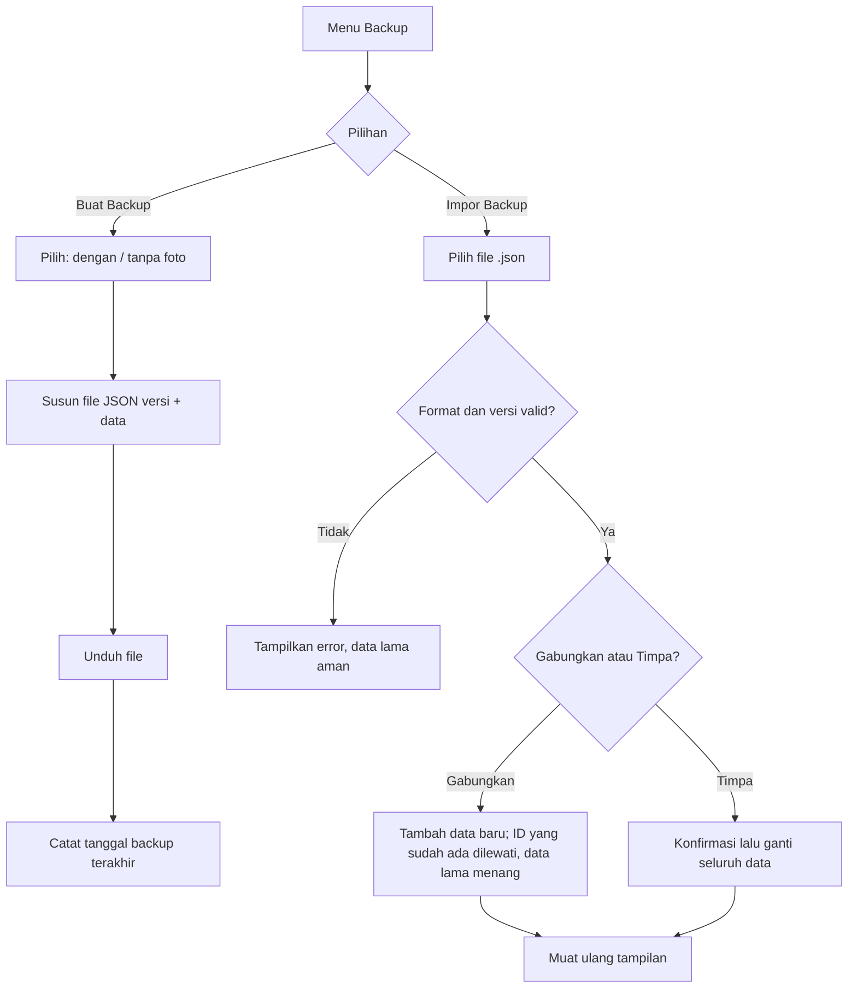
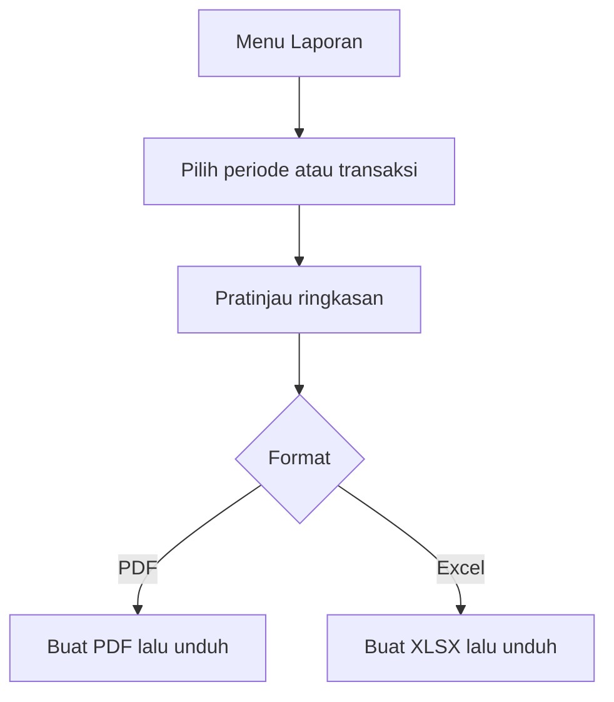
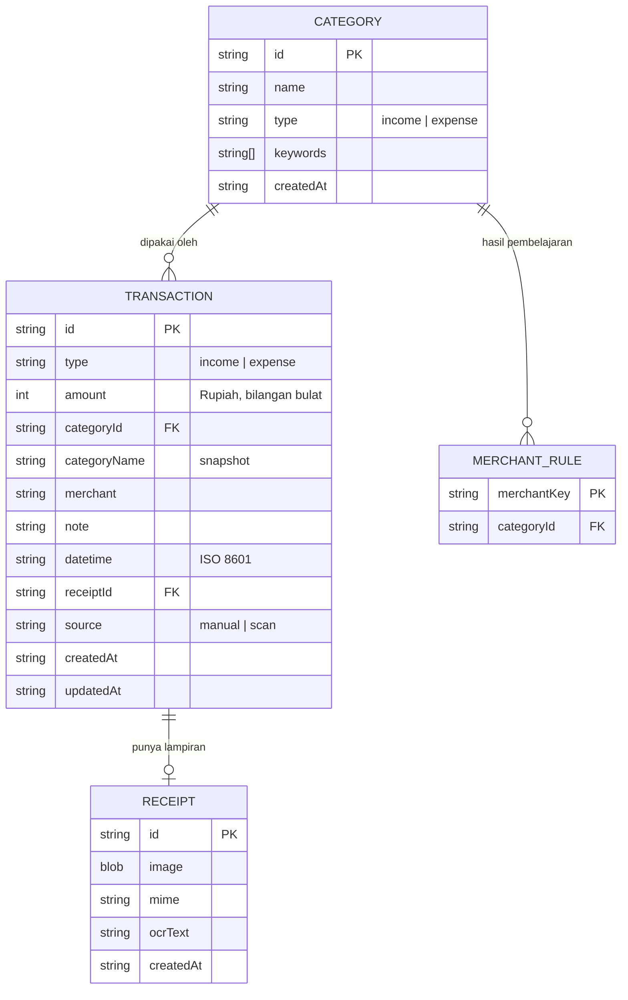

# PRD: CatatDuit (Pencatat Keuangan — PWA)

| | |
|---|---|
| **Versi** | 0.3 |
| **Tanggal** | 24 Okt 2026 |
| **Status** | Draft, menunggu persetujuan |
| **Platform** | Web / PWA (HTML, CSS, JavaScript murni) |

---

## 1. Ringkasan

Aplikasi pencatat keuangan sederhana yang berjalan sepenuhnya di browser. Tanpa login, tanpa server, dan data tersimpan di perangkat pengguna. Pengguna bisa mencatat pemasukan dan pengeluaran, melihat rekap saldo harian, memotret struk belanja yang dibaca otomatis (OCR), lalu mengekspor laporan ke PDF atau Excel.

## 2. Latar Belakang dan Masalah

- Mencatat keuangan di buku atau catatan HP itu merepotkan, sehingga sering terlewat.
- Aplikasi yang ada biasanya memaksa login, memakai server, atau punya fitur terlalu banyak.
- Pengguna ingin pencatatan cepat, bahkan cukup dengan memotret struk.

## 3. Tujuan dan Non-Tujuan

### Tujuan
1. Mencatat transaksi dalam kurang dari 15 detik (manual) atau kurang dari 30 detik (scan struk).
2. Menampilkan saldo dan rekap harian secara jelas.
3. Data tetap milik pengguna: offline, tanpa akun, bisa dibackup kapan saja.
4. Menghasilkan laporan PDF dan Excel untuk periode tertentu.

### Non-Tujuan (di luar versi 1)
- Login, multi-pengguna, atau sinkronisasi antar perangkat.
- Terhubung ke rekening bank atau e-wallet.
- Anggaran bulanan, tagihan berulang, dan multi-mata-uang.
- OCR berbasis AI cloud (disiapkan hook-nya saja, lihat bagian 14).

## 4. Pengguna dan Peran

Satu peran saja: **Pengguna**. Pengguna memiliki akses penuh ke semua fitur dan data di perangkatnya sendiri.

**Persona:** orang yang ingin mengelola uang harian pribadi atau usaha kecil, nyaman memakai HP, dan tidak mau repot membuat akun.

## 5. Ruang Lingkup Fitur

| ID | Fitur | Prioritas |
|---|---|---|
| F1 | Catat pemasukan dan pengeluaran (CRUD) | P0 |
| F2 | Kelola kategori (tambah, ubah, hapus) | P0 |
| F3 | Dashboard: saldo, ringkasan, grafik saldo harian | P0 |
| F4 | Jam dan tanggal real-time | P0 |
| F5 | Riwayat transaksi + filter + pencarian | P0 |
| F6 | Backup dan restore (JSON) | P0 |
| F7 | PWA: dapat dipasang dan jalan offline | P0 |
| F8 | Scan struk (kamera) + OCR + saran kategori | P1 |
| F9 | Simpan foto struk sebagai lampiran transaksi | P1 |
| F10 | Ekspor struk ke gambar (PNG) | P1 |
| F11 | Ekspor laporan ke PDF dan Excel | P1 |
| F12 | Pengingat backup | P2 |
| F13 | Pembelajaran kategori dari koreksi pengguna | P2 |

## 6. User Stories dan Kriteria Penerimaan

### F1. Transaksi
> Sebagai pengguna, saya ingin mencatat pemasukan dan pengeluaran agar saldo saya selalu akurat.

- Form berisi: jenis, jumlah, kategori, tanggal dan jam (default sekarang), catatan (opsional).
- Jumlah hanya angka bulat positif dan diformat Rupiah saat mengetik.
- Transaksi bisa diedit dan dihapus. Hapus meminta konfirmasi.
- Saldo dan rekap langsung diperbarui setelah simpan, tanpa muat ulang halaman.

### F2. Kategori
> Sebagai pengguna, saya ingin mengatur kategori sendiri.

- Kategori terpisah untuk pemasukan dan pengeluaran.
- Pengguna bisa menambah, mengganti nama, dan menghapus kategori.
- Nama kategori unik per jenis (tanpa memperhatikan huruf besar/kecil).
- Menghapus kategori yang sudah dipakai: transaksi lama **tetap menyimpan nama kategorinya** (snapshot), dan kategori hilang dari pilihan baru.
- Saat pertama dipakai, tersedia kategori bawaan yang boleh diubah atau dihapus.

### F3. Dashboard
- Menampilkan saldo total, pemasukan dan pengeluaran hari ini, serta bulan ini.
- Grafik batang saldo akhir 7 hari terakhir.
- Daftar transaksi hari ini.
- Tombol cepat "+ Catat Transaksi" dan "Scan Struk".

### F4. Jam real-time
- Menampilkan hari, tanggal, bulan, tahun, jam, menit, dan detik.
- Diperbarui tiap detik mengikuti waktu perangkat, dan tetap akurat setelah tab kembali aktif.

### F5. Riwayat
- Daftar transaksi dikelompokkan per tanggal, terbaru di atas.
- Filter: rentang tanggal, jenis, kategori. Pencarian pada catatan dan nama toko.
- Setiap baris bisa dibuka untuk detail, edit, hapus, lihat foto struk, dan cetak struk gambar.
- Bisa memilih beberapa transaksi (centang) untuk dimasukkan ke laporan.

### F6. Backup dan Restore
- **Buat backup:** mengunduh file `.json` (pilihan: dengan atau tanpa foto struk).
- **Impor backup:** memilih file, validasi format dan versi, lalu pilih **Gabungkan** atau **Timpa semua**. Pada Gabungkan, ID yang sudah ada dilewati apa pun isinya — data di perangkat selalu menang.
- Jika file rusak atau tidak dikenal, tampil pesan jelas dan data lama tidak berubah.
- Tanggal backup terakhir dicatat.

### F7. PWA
- Bisa dipasang ke layar utama (Android dan iOS).
- Prompt pemasangan ditawarkan sejak kunjungan awal beserta alasannya: di iOS, data hanya aman dari penghapusan otomatis Safari saat aplikasi terpasang di layar utama.
- Seluruh fitur inti berjalan offline setelah kunjungan pertama.
- Ada ikon, nama, dan warna tema.

### F8. Scan Struk
> Sebagai pengguna, saya ingin memotret struk dan datanya terisi otomatis.

- Tombol "Scan Struk" memakai `<input type="file" accept="image/*" capture="environment">` — membuka kamera bawaan OS dan tetap menyediakan pilihan galeri. `getUserMedia` tidak dipakai karena tidak andal di PWA standalone iOS.
- Aplikasi membaca teks lalu menebak: **total, tanggal, nama toko, kategori**.
- Layar konfirmasi menampilkan hasil tebakan, dan pengguna bisa mengoreksi semuanya sebelum menyimpan.
- Tidak ada transaksi tersimpan tanpa konfirmasi pengguna.
- Jika OCR gagal atau hasilnya kosong, form manual tetap terbuka dengan foto terlampir.
- Ada indikator proses dan tombol batal.

### F9. Lampiran Foto
- Foto diperkecil dan dikompres (target sekitar 100–200 KB, sisi terpanjang maksimal 1280 px).
- Foto bisa dilihat dari detail transaksi, diganti, atau dihapus.
- Menghapus transaksi otomatis menghapus foto struknya dari IndexedDB (storage tidak bocor).

### F10. Struk Gambar
- Dari detail transaksi, pengguna menekan "Jadikan Struk" dan aplikasi membuat gambar PNG bergaya struk (nama aplikasi, tanggal, kategori, catatan, jumlah).
- Gambar bisa diunduh atau dibagikan.

### F11. Laporan PDF dan Excel
- Pilih periode (hari ini, 7 hari, bulan ini, bulan lalu, kustom) atau transaksi yang dicentang.
- Isi laporan: ringkasan (total pemasukan, pengeluaran, selisih), rincian per kategori, daftar transaksi, dan saldo harian.
- Format: **PDF** untuk dibaca dan dicetak, **XLSX** untuk diolah (kolom terpisah dan angka bertipe angka, bukan teks).

### F12 dan F13
- Dashboard menampilkan peringatan jika backup terakhir lebih dari N hari (default 7).
- Jika pengguna mengubah kategori hasil tebakan untuk suatu toko, pilihan itu diingat untuk scan berikutnya.

## 7. Alur Pengguna (Flowchart)

### 7.1 Catat transaksi manual



### 7.2 Scan struk



### 7.3 Backup dan restore



### 7.4 Laporan



## 8. Struktur Layar

| Layar | Isi utama |
|---|---|
| Beranda | Jam real-time, saldo, ringkasan, grafik 7 hari, transaksi hari ini |
| Catat Transaksi | Form transaksi |
| Scan Struk | Kamera, proses OCR, konfirmasi |
| Riwayat | Daftar, filter, pencarian, detail |
| Kategori | Daftar dan pengelolaan kategori |
| Laporan | Pilih periode dan ekspor |
| Pengaturan | Backup, impor, pengingat, aturan kata kunci kategori, hapus semua data |

Navigasi: bilah bawah dengan Beranda, Riwayat, tombol tengah (+), Laporan, dan Pengaturan. Desain awal layar Beranda dan Catat Transaksi sudah dibuat di canvas desain.

## 9. Model Data

### 9.1 Diagram relasi



### 9.2 Penempatan penyimpanan

| Data | Tempat | Alasan |
|---|---|---|
| Kategori, transaksi, aturan toko, pengaturan | `localStorage` | Sesuai permintaan, sederhana, cepat |
| Foto struk (RECEIPT) | `IndexedDB` | Ukuran besar, melewati batas sekitar 5 MB |

Aturan data:
- Uang disimpan sebagai **bilangan bulat Rupiah**, tidak pernah desimal.
- Waktu disimpan sebagai ISO 8601 dan ditampilkan sesuai zona waktu perangkat.
- ID dibuat di sisi klien (UUID) supaya penggabungan backup aman.
- Semua data punya `schemaVersion` untuk migrasi di masa depan.
- Laporan (F11) dikelompokkan berdasarkan `categoryId`; kategori yang sudah dihapus ditampilkan memakai `categoryName` snapshot. Ganti nama kategori berlaku untuk seluruh transaksi lama (karena dikelompokkan per ID).

### 9.3 Format file backup

```json
{
  "app": "catatduit",
  "schemaVersion": 1,
  "exportedAt": "2026-10-24T09:00:00.000Z",
  "includesReceipts": true,
  "categories": [],
  "transactions": [],
  "merchantRules": [],
  "settings": {},
  "receipts": [
    { "id": "…", "mime": "image/jpeg", "dataBase64": "…", "ocrText": "…" }
  ]
}
```

## 10. Pembacaan Struk (OCR) dan Saran Kategori

**Mesin:** Tesseract.js berjalan di perangkat, dengan file bahasa Indonesia dan Inggris disimpan di folder aplikasi supaya tetap bisa dipakai offline.

**Prapemrosesan gambar:** perkecil, ubah ke skala abu-abu, naikkan kontras, dan binarisasi sederhana.

**Ekstraksi:**

| Data | Aturan |
|---|---|
| Total | Cari baris berkata kunci `TOTAL`, `GRAND TOTAL`, `JUMLAH`, `TOTAL BAYAR`. Jika tidak ada, ambil angka terbesar yang masuk akal. |
| Tanggal | Cocokkan pola `dd/mm/yyyy`, `dd-mm-yyyy`, `dd MMM yyyy`. Jika gagal, pakai hari ini. |
| Toko | Baris teks bermakna pertama di bagian atas struk. |

**Saran kategori (urutan prioritas):**
1. Aturan toko hasil koreksi pengguna sebelumnya.
2. Kata kunci pada kategori (bisa diatur pengguna).
3. Jika tidak ada yang cocok, kategori dikosongkan dan pengguna memilih sendiri.

**Kata kunci awal (contoh):** Indomaret, Alfamart → Belanja · Pertamina, SPBU → Transport · Resto, Cafe, Warung → Makan.

**Prinsip:** hasil OCR adalah usulan. Pengguna selalu mengonfirmasi sebelum data disimpan.

## 11. Persyaratan Non-Fungsional

| Aspek | Target |
|---|---|
| Performa | Halaman utama tampil kurang dari 2 detik. Daftar tetap lancar pada 5.000 transaksi. |
| OCR | Selesai dalam sekitar 10 detik untuk satu struk di HP menengah. |
| Offline | Semua fitur jalan tanpa internet setelah kunjungan pertama. |
| Privasi | Tidak ada data atau foto yang dikirim keluar perangkat. Tanpa pelacak dan analitik. |
| Keamanan | Semua teks yang dirender di-escape (mencegah XSS dari catatan atau hasil OCR). Berkas impor divalidasi. |
| Responsif | Mobile-first, nyaman dari lebar 360 px sampai desktop. |
| Aksesibilitas | Target sentuh minimal 44 px, kontras teks minimal 4.5:1, semua tombol bisa dijangkau keyboard, label pada kolom isian. |
| Bahasa | Indonesia. Format angka `Rp 1.250.000`, tanggal `24 Okt 2026`. |
| Browser | Chrome dan Edge versi terbaru, Safari iOS 15+, Firefox versi terbaru. |

## 12. Risiko dan Mitigasi

| Risiko | Dampak | Mitigasi |
|---|---|---|
| Data hilang karena browser dibersihkan | Tinggi | Pengingat backup, tombol backup mudah dijangkau, mintakan `navigator.storage.persist()` (Chrome/Firefox; Safari mengabaikannya) |
| iOS Safari menghapus data situs yang 7 hari tidak dibuka (ITP) | Tinggi | Dorong pemasangan ke layar utama sejak awal — PWA terpasang dikecualikan dari penghapusan ini; pengingat backup tetap ada |
| Akurasi OCR rendah | Sedang | Layar konfirmasi wajib, form manual selalu tersedia, panduan memotret yang baik |
| Penyimpanan penuh karena foto | Sedang | Kompresi foto, indikator pemakaian penyimpanan, opsi hapus foto lama |
| Perilaku `localStorage`/PWA di iOS Safari berbeda | Sedang | Uji di iOS sejak awal, jangan bergantung pada fitur yang tidak didukung |
| Pengguna menggunakan dua perangkat dan data tidak sinkron | Rendah | Dijelaskan di aplikasi, solusinya lewat backup dan impor |
| Impor backup merusak data | Tinggi | Validasi ketat, pilihan Gabungkan, konfirmasi sebelum Timpa, simpan salinan otomatis sebelum menimpa |

## 13. Kasus Tepi

- Jumlah nol, negatif, atau di atas Rp 999.999.999.999 ditolak dengan pesan jelas.
- Tanggal di masa depan diperbolehkan tetapi diberi peringatan.
- Dua kategori dengan nama sama (beda huruf besar/kecil) ditolak.
- Kamera ditolak izinnya: tawarkan pilih dari galeri.
- Struk berisi banyak angka dan total salah terbaca: pengguna koreksi di layar konfirmasi.
- Jam perangkat diubah pengguna: waktu tampil mengikuti jam perangkat.
- Pengguna menghapus semua data: wajib konfirmasi dua langkah dan menawarkan backup terlebih dahulu.
- Backup dari versi aplikasi lebih baru: tolak dengan pesan "perbarui aplikasi".

## 14. Rencana Pengembangan

| Tahap | Isi |
|---|---|
| **MVP (Tahap 1)** | F1–F7: transaksi, kategori, dashboard, jam, riwayat, backup, PWA |
| **Tahap 2** | F8–F9: scan struk, OCR, lampiran foto |
| **Tahap 3** | F10–F11: struk gambar, laporan PDF dan Excel |
| **Tahap 4** | F12–F13: pengingat backup dan pembelajaran kategori |
| **Ke depan** | Opsi "Scan dengan AI" memakai API key milik pengguna sendiri, anggaran bulanan, tema gelap, PIN kunci aplikasi |

## 15. Struktur Berkas yang Direncanakan

```
catatduit/
├── index.html
├── manifest.json
├── sw.js                  # service worker (cache offline)
├── css/
│   └── style.css
├── js/
│   ├── app.js             # inisialisasi dan navigasi
│   ├── store.js           # localStorage + IndexedDB
│   ├── transactions.js
│   ├── categories.js
│   ├── dashboard.js       # saldo, grafik, jam real-time
│   ├── receipt.js         # kamera, OCR, ekstraksi, saran kategori
│   ├── backup.js
│   └── export.js          # PDF, XLSX, gambar struk
├── vendor/
│   ├── tesseract/         # mesin dan data bahasa OCR
│   └── xlsx/              # SheetJS, lazy-load saat ekspor (Tahap 3)
└── icons/                 # ikon PWA
```

## 16. Metrik Keberhasilan

Aplikasi tanpa pelacak, jadi metrik ini diukur lewat uji pemakaian langsung.

- Mencatat transaksi manual dalam kurang dari 15 detik.
- Minimal 80% total pada struk jelas terbaca benar pada uji 20 struk.
- Backup dan impor mengembalikan data 100% identik pada uji bolak-balik.
- Skor Lighthouse PWA terpenuhi dan fitur inti berjalan di mode pesawat.

**Keputusan pengujian (tanpa framework):**
- Aturan ekstraksi OCR (total, tanggal, toko) ditulis sebagai fungsi murni dan diuji lewat halaman `test.html` berisi assert sederhana.
- Uji bolak-balik backup → impor → backup menghasilkan file identik.
- Uji manual di perangkat nyata: 20 struk, install PWA, mode pesawat, iOS dan Android.

## 17. Keputusan Terbuka

1. **PDF dan Excel (DITUTUP):** PDF dibuat lewat halaman pratinjau + `window.print()` + print stylesheet — tanpa library, offline, nol byte tambahan. XLSX memakai SheetJS yang di-vendor di `vendor/xlsx/` dan dimuat lazy saat ekspor; XLSX adalah arsip ZIP, membuatnya tanpa library berarti menulis ZIP writer sendiri.
2. **Hosting (DITUTUP):** Vercel — live di https://catatduit-dm85.vercel.app/ (HTTPS otomatis untuk PWA dan kamera).
3. **Nama & Ikon (DITUTUP): CatatDuit** — repo publik `Curzyori/catatduit` (orang lain fork dari sini); nama pendek PWA: "CatatDuit". Ikon: pixel-art struk + koin "C", diterapkan sebagai ikon resmi PWA (192/512/maskable).
4. **Kategori bawaan:** daftar awal yang diinginkan (usulan di bawah).
5. **Tema (DITUTUP):** hanya terang untuk v1, konsisten dengan Non-Tujuan (bagian 3); tema gelap masuk fase "Ke depan".

**Usulan kategori bawaan.** Pengeluaran: Makan, Transport, Belanja, Tagihan, Kesehatan, Hiburan, Lainnya. Pemasukan: Gaji, Bonus, Usaha, Lainnya.

## 18. Kebutuhan dan Prasyarat

| Kebutuhan | Detail | Dibutuhkan pada |
|---|---|---|
| Hosting statis + HTTPS | Netlify / GitHub Pages / Vercel (lihat Keputusan Terbuka #2); kamera dan PWA wajib HTTPS | Deploy MVP |
| File bahasa OCR | `ind.traineddata` + `eng.traineddata` di `vendor/tesseract/`; dimuat lazy (bukan cache awal service worker) agar kunjungan pertama tetap ringan | Tahap 2 |
| SheetJS | Satu berkas di `vendor/xlsx/`, dimuat lazy saat ekspor | Tahap 3 |
| Ikon PWA | Set 192 px, 512 px, dan maskable | MVP |
| Perangkat uji | Android Chrome + iPhone Safari (perangkat asli: kamera, install, perilaku ITP) | Sejak MVP |

## 19. Riwayat Perubahan

| Versi | Tanggal | Perubahan |
|---|---|---|
| 0.1 | 24 Okt 2026 | Draf awal |
| 0.2 | 31 Okt 2026 | Revisi hasil review: risiko ITP iOS + prompt pemasangan, keputusan PDF/Excel ditutup, aturan grouping laporan, kamera via file input, aturan merge backup, hapus foto ikut transaksi, bagian Prasyarat (18), keputusan pengujian, batas jumlah Rp 999 miliar, tema ditutup |
| 0.3 | 31 Okt 2026 | Nama aplikasi ditetapkan: **CatatDuit** (repo publik `Curzyori/catatduit`); identitas backup `app` dan folder proyek ikut disesuaikan |
